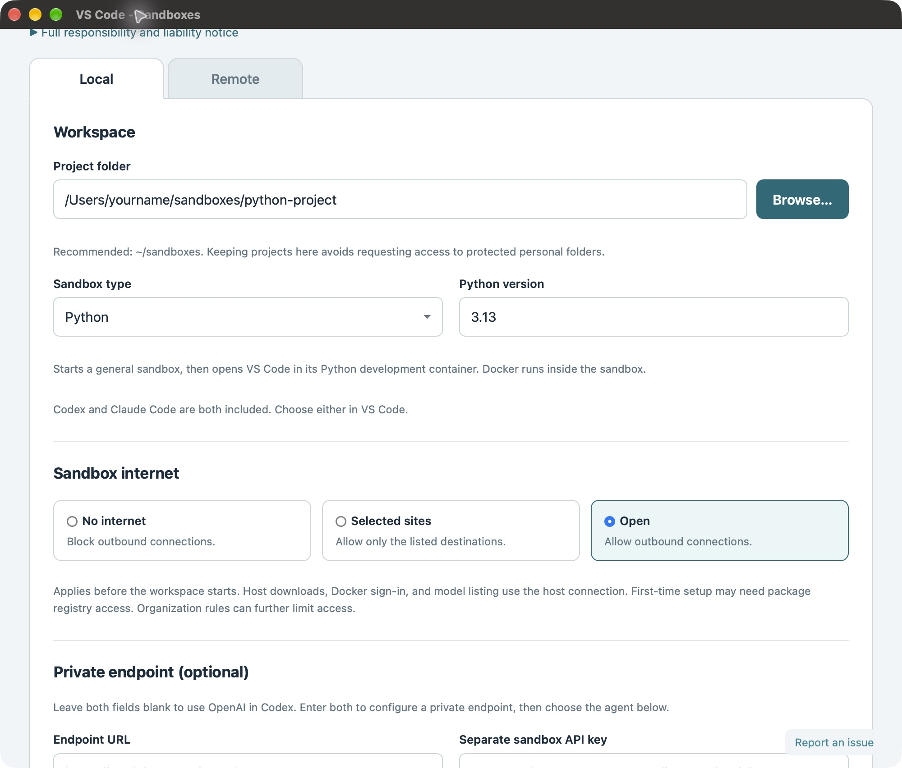
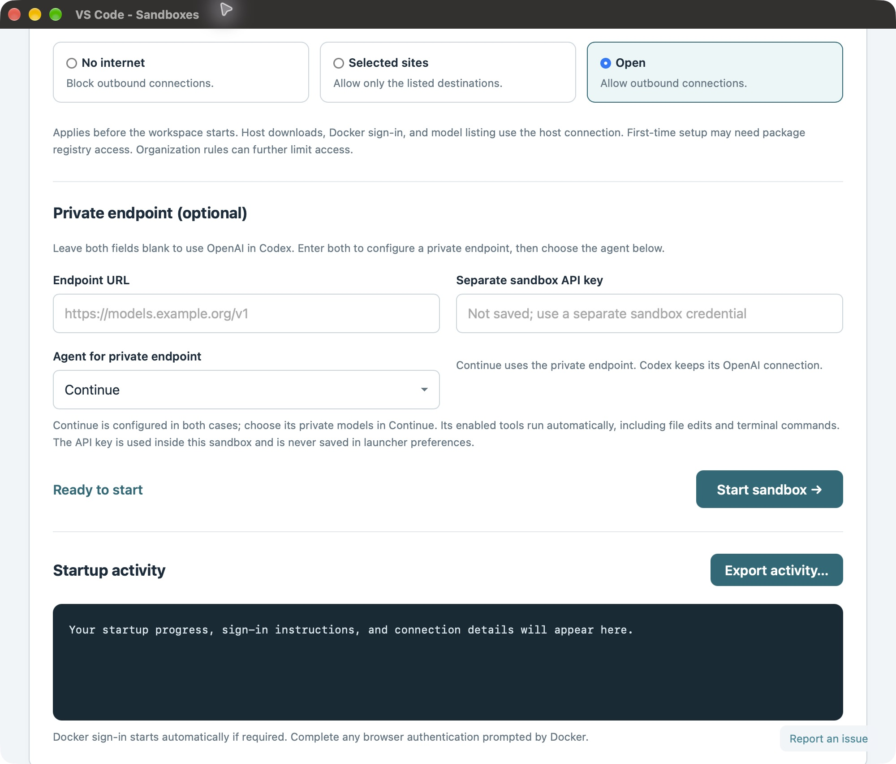
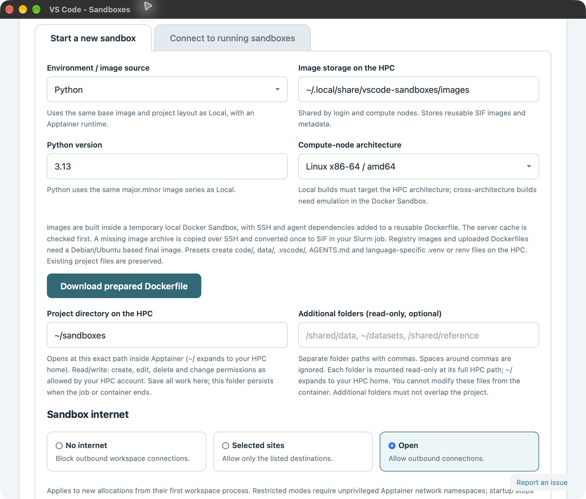
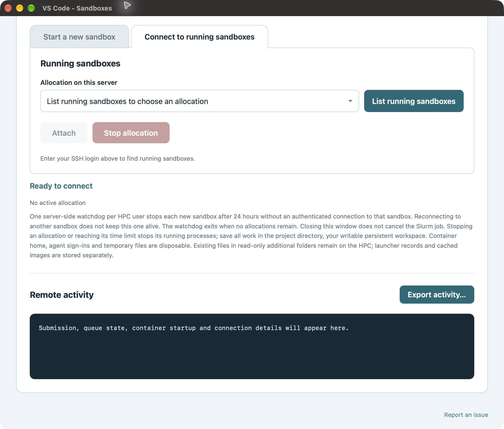

# VS Code - Sandboxes

One macOS application or Windows executable that creates reproducible development environments
with Docker Sandboxes and opens them in Visual Studio Code. Choose **Python**, **R**,
or **General bioinformatics** in the same startup window.

Each sandbox keeps project files on your computer while running the development tools,
language runtime, and both Codex and Claude Code in an isolated sandbox.

The unified launcher is self-contained and includes all three sandbox types. Their setup scripts, runtime
launchers, templates, and editor configuration are packaged from this repository.
Setup uses a sparse checkout of the separate `skills/` repository containing only
`match-code-data` and `set-vscode-r-version` for Codex and Claude to discover, but launcher setup and execution never load or
copy launcher files from that clone.
If an existing `skills/` Git repository has no origin, setup first prepares a fresh
clone, preserves the original in `skills.backup.XXXXXX/skills`, and reports the backup
location. A different origin or a Git configuration error stops setup without replacing it.

**Use at your own risk.** Users are responsible for their activities, agent actions,
data, credentials, and costs. To the maximum extent permitted by applicable law,
the authors and contributors provide no warranty and accept no liability for
resulting claims, damage, or loss. Read the [responsibility notice](DISCLAIMER.txt)
and [liability information](#user-responsibility-and-liability).

## Contents

- [User responsibility and liability](#user-responsibility-and-liability)
- [Available sandboxes](#available-sandboxes)
  - [Python Sandbox](#python-sandbox)
  - [R Sandbox](#r-sandbox)
  - [Bioinformatics Sandbox](#bioinformatics-sandbox)
- [Startup window and connection settings](#startup-window-and-connection-settings)
- [Remote HPC workspaces](#remote-hpc-workspaces)
- [macOS](#macos)
  - [macOS requirements](#macos-requirements)
  - [Verify macOS requirements before downloading](#verify-macos-requirements-before-downloading)
  - [Install the macOS application](#install-the-macos-application)
  - [Open an unsigned sandbox app](#open-an-unsigned-sandbox-app)
  - [Create projects on macOS](#create-projects-on-macos)
- [Windows](#windows)
  - [Windows requirements](#windows-requirements)
  - [Verify Windows requirements before downloading](#verify-windows-requirements-before-downloading)
  - [Download the Windows executable](#download-the-windows-executable)
  - [Unblock a downloaded executable](#unblock-a-downloaded-executable)
  - [Create projects on Windows](#create-projects-on-windows)
- [Using the generated project](#using-the-generated-project)
  - [What is created](#what-is-created)
  - [Open the project again](#open-the-project-again)
  - [Working in the sandbox](#working-in-the-sandbox)
- [Troubleshooting](#troubleshooting)
- [For developers](#for-developers)

## Available sandboxes

### Python Sandbox

Python Sandbox starts a general Docker-enabled sandbox and pulls the selected Python
image inside it. VS Code opens its development container with a project virtual
environment, Jupyter extensions, and either Codex or Claude Code.

### R Sandbox

R Sandbox starts a general Docker-enabled sandbox and pulls the selected R
major/minor image inside it. VS Code opens its development container with a
project R library managed by `renv`, R language tooling, Quarto, and both coding agents.

### Bioinformatics Sandbox

Bioinformatics Sandbox creates a language-neutral scientific project for mixed Python,
R, notebooks, command-line tools, and containerized workloads. It provides the
code/data layout, VS Code tooling, and either Codex or Claude Code.

## Startup window and connection settings

Open **VS Code - Sandboxes** and select the **Project folder** first. Type
its path or click **Browse…** to choose or create a folder. Editing the field does
not open the picker. Then choose the sandbox type and Python/R version for a new
project. Changing types keeps your selected folder.

The screenshots below show the macOS launcher in v1.2.0, using example paths
and empty credential fields.

**Local setup:** choose the project, environment and internet policy.



When the folder already contains a sandbox project, the launcher restores its
language/version and offers **Restart sandbox**. It runs the existing project
launcher without cloning skills or regenerating setup files. Successfully
initialized Python/R containers are restarted and verified without reinstalling
the environment. Missing containers are recreated from the existing setup.
User edits and staged changes remain untouched on restarts.

**Export activity…**, on the right of **Startup activity**, saves a text snapshot
of the startup log and any error. It remains available during startup and after
failure. API keys are redacted. macOS uses a Save dialog; Windows downloads the
text file through Edge.

New project suggestions live under `~/sandboxes` (the `sandboxes`
folder in your home directory on Windows). This keeps projects outside protected
personal folders and normally avoids needing Full Disk Access on macOS. Choosing
another location opens an explanation with **Use ~/sandboxes**, **Keep selected
folder**, and **Cancel**. Existing saved projects keep their original path and get
the same review; choosing the recommended path never moves or deletes their files.
Generated project launchers remain bound to their existing project.

Terminal is not opened. Windows uses Microsoft Edge in app mode (Edge must be installed);
macOS uses a native WebKit window. Generated project apps/executables show the same
internet and AI connection choices every time you open a workspace.

Choose **No internet**, **Selected sites**, or **Open** before starting. Selected
sites accepts comma-separated hostnames, `*.example.org` or `**.example.org`
subdomain patterns, and optional ports. A private endpoint’s host is added
automatically with a warning. Private
endpoints cannot be used with No internet; startup is blocked with an explanation.
Include any additional package registries needed for setup. The restrictions apply to the sandbox;
base sandbox-template downloads, Docker authentication, and host
VS Code installation still use the host connection. Skills Git clones, Python/R image pulls, feature
builds, and dependency installation run inside the sandbox and obey its policy. A first launch without package
registry access can fail until its dependencies have been prepared.

Docker's local default network preset is shared. If Selected sites needs a
change from an existing open/balanced preset, the app lists current sandboxes
and offers **Apply to all sandboxes** or **Cancel startup**. The confirmation
explains that Docker's reset clears local custom rules and stops running
sandboxes. Those sandboxes must be restarted afterwards. Cancelling leaves the
shared policy unchanged. The app never resets the shared policy without this
confirmation. A new Docker installation with no preset is initialized to the
chosen mode. Existing organization policies can further restrict access.

**Selected sites** starts with editable defaults for container registries and their
layer-download hosts, npm/Node, GitHub, Linux packages, and VS Code installation.
Python adds PyPI and Conda hosts; R adds CRAN, Bioconductor, and R-universe hosts;
General bioinformatics includes both sets. Each type retains its own edits.
Use **Restore default sites** to reset that type's list. Only the displayed list
is applied. Add model endpoints, private registries, custom package mirrors, or
additional redirect hosts when needed; arbitrary registries and mirrors cannot
all be covered by a fixed list.

The registry and editor defaults follow [Docker's allowlist](https://docs.docker.com/desktop/enterprise/allow-list/),
[GitHub's registry/download hosts](https://docs.github.com/en/actions/reference/runners/self-hosted-runners),
[Microsoft's registry firewall guidance](https://learn.microsoft.com/en-us/azure/machine-learning/how-to-prevent-data-loss-exfiltration),
and [VS Code's network requirements](https://code.visualstudio.com/docs/setup/network).

Each workspace starts behind a deny-all guard while connection settings and
network rules are applied. Selected sites requires a deny-by-default preset;
extra kit/global destinations are blocked for that workspace. If an existing
broad rule cannot be narrowed safely, startup stops with the guard in place.
This uses Docker's hostname-based enforcement and inherits its documented
[hostname blocking limitations](https://docs.docker.com/ai/governance/local/network-rules/).

The **Private endpoint (optional)** card shows the endpoint URL and separate
sandbox API key side by side. Leave both blank for the default OpenAI connection
in Codex. Enter both, then choose **Continue** or **Codex** in the second row.
Continue is configured with the private endpoint in either case. **Continue** is
the default and leaves Codex using OpenAI with its own sandbox sign-in. Choosing
**Codex** also configures Codex with the private endpoint and the same sandbox API
key. There is no model picker or connection-file workflow in startup.



Private startup fetches `/models` with the supplied sandbox API key and writes the
available IDs and routing aliases into `~/.continue/config.yaml` inside the sandbox.
Choose a model in Continue. The configuration uses Continue's OpenAI-compatible
provider, chat/edit/apply roles, and `/chat/completions`. An empty list or discovery
failure stops startup. No reusable configuration file or cached Codex TOML is
created on the host. Existing sandbox Continue settings are backed up and restored
when starting with both private fields blank.

When **Codex** is selected, startup also writes the private provider, endpoint,
authentication key, and first discovered model into the sandbox's
`~/.codex/config.toml`. This uses the Responses API, so the endpoint must support
`/responses` as well as `/models`; Continue uses `/chat/completions`. The sorted
model list used for Continue supplies Codex's initial model. Codex's original
configuration is backed up once and restored when switching back to Continue or
clearing the private endpoint fields. Host Codex settings and authentication are
not changed.

The distributed launcher installs Continue **2.0.0** inside the Linux sandbox
before VS Code opens, with enabled tools defaulting to **Automatic**, including
file edits and terminal commands. Excluded tools remain excluded and Continue's
runtime file/command checks remain in place. These are distribution defaults,
not a copy of the launcher's author's IDE preferences; explicit user changes in
Continue can still override them. This applies to fresh Python, R, and general
bioinformatics sandboxes on macOS and Windows.

Because this Continue version exposes IDE policies as user UI state rather than
model-YAML settings, preparation adjusts the pinned extension's built-in defaults
and GUI fallback inside the sandbox. The official Marketplace archive is verified
against a platform-specific SHA-256 before extraction; the exact policy layout is
checked before changing it. The extension is marked pinned, its license is retained,
and prepared artifacts are cached for offline reuse. A version/checksum/layout
mismatch stops startup; changing versions requires reviewing the defaults again.
The launcher never changes the host's Continue extension or copies host tool-policy
state. Initial setup requires the displayed VS Code Marketplace/CDN hosts.

Before a private startup, the launcher sets `remote.extensionKind` for
`Continue.continue` to `["workspace"]` in local VS Code user settings. VS Code
chooses the extension host before container/workspace settings arrive, so this
local setting is needed when Continue is also installed on the host. It applies
to Continue in remote VS Code windows; other extension settings and comments are
preserved. Host Continue model settings and credentials are not changed.

Continue runs as a workspace extension inside the container, with its sandbox-only
configuration mounted into its home directory. Existing containers also receive
the configuration before VS Code opens. The primary sidebar stays left and the
secondary agent sidebar stays visible on the right. Continue appears with the
other AI panes there; VS Code retains the user's view arrangement. If changing
an already open IDE, run **Developer: Reload Window** to reload extension placement
and configuration. The endpoint URL and private API key remain required.

For a LiteLLM/OpenAI-compatible gateway, enter its **Endpoint URL** and separate
**API key**. Startup sends a host-side `GET` to the base URL with `/models`
appended (for example, `/v1/models`) and a Bearer authorization header, then makes
the returned models available in Continue. Choose the model there. The key remains masked in the startup window for that session and is
not saved in launcher preferences. Model discovery follows only same-origin redirects
and never sends the key to a different origin. Sandbox network settings still
govern subsequent agent requests inside the sandbox.

The private API key is required whenever a private URL is entered. It is readable
by agents inside the sandbox and travels through a private temporary startup
manifest and the sandbox's own Continue configuration (and Codex configuration
when Codex is selected). It is never saved in
launcher preferences, project files, or host Continue settings. URL query
parameters are stripped except a validated `api-version` value. Host sign-in files
and host environment credentials are not imported.

Launcher preferences live outside the project:

- macOS: `~/Library/Application Support/VS Code Sandboxes/`;
- Windows: `%AppData%\VS Code Sandboxes\`.

Each agent's sandbox sign-in state survives container recreation.
An endpoint on the host must use a hostname reachable from the sandbox;
`localhost` inside the sandbox refers to the sandbox itself.

## Remote HPC workspaces

Building a missing Remote image requires at least **20 GiB free on the local
drive and inside the temporary builder**; larger/custom images can need more.
The launcher checks before starting and stops the temporary build if host free
space falls below a 2 GiB reserve. Registry metadata is resolved without
pre-pulling duplicate images, and BuildKit exports directly to the upload
archive. Existing verified local/server images can be reused without a new
build. Storage errors require freeing space (or using a server image), rather
than changing the Python/R version or Dockerfile dependencies.

Remote agent containment, exact Apptainer flags, syscall restrictions, filesystem
exposure, image portability and remaining limitations are documented in
[APPTAINER.md](APPTAINER.md). New allocations use the strict policy; existing
running allocations must be replaced to receive it.

The startup window has **Local** and **Remote** browser-style tabs. Local keeps
the Docker Sandboxes workflow. Remote opens VS Code inside Apptainer on a Slurm
compute node through your existing login-node SSH alias and an `srun` step inside
the allocation. Compute-node hostnames are display labels only: the launcher never
connects to a compute-node address or its SSH daemon. The container SSH endpoint
listens on loopback and its protocol stream travels through Slurm.

**Start a new Remote sandbox:** select the image, language version, architecture
and project/data folders.



Choose an **Environment / image source**:

| Source | Image preparation |
| --- | --- |
| Python | Uses Local's `mcr.microsoft.com/devcontainers/python:<major.minor>-bookworm` base; specify the Python series. |
| R | Uses Local's `ghcr.io/rocker-org/devcontainer/r-ver:<version>` base; specify an R series or patch version. |
| General bioinformatics | Uses the same `docker.io/docker/sandbox-templates:shell-docker` base as the supported Local shell runtime. |
| Online container registry | Enter an OCI reference such as `docker.io/library/ubuntu:24.04` or `docker://ghcr.io/your-org/image:tag`. Docker Hub web page URLs are not image references. |
| Upload a Dockerfile | Select a self-contained Dockerfile from your laptop, up to 512 KiB. Its final image must be Debian/Ubuntu based. Local COPY/ADD context files are not uploaded; put their creation in the recipe or use online sources. |
| Cached image on server | Automatically loads ready SIFs in the next row from the configured image cache; reuse the original preset/version/project template. No local Docker is needed. |
| Existing SIF on the HPC | Enter an absolute path to an existing compatible `.sif`; no local build or local Docker Sandboxes is needed. |

When a requested image is absent from the server cache, the launcher builds **inside a dedicated
local Docker Sandbox**, adding SSH, VS Code and coding-agent dependencies to a
portable Dockerfile. It uses the sandbox's Docker Engine rather than a host Docker
socket. These modes require local Docker Sandboxes as well as VS Code and OpenSSH.
Automatic missing-tool setup is available in the Remote tab. Builds have network
access scoped to their temporary build sandbox, subject to organization rules.

Set **Compute-node architecture** to amd64 or arm64 to match the HPC. A different
laptop architecture uses a pinned QEMU/binfmt installer inside the temporary
sandbox; cross-architecture builds can take considerably longer. The launcher
retains the complete Dockerfile, pinned base/Node references, image identity and
recipe hash locally, uploads the Docker archive over SSH with checksum validation,
and converts it to SIF **inside the Slurm job**, rather than building on the login
node. **Download prepared Dockerfile** saves the portable recipe before building;
the recipe retained after a successful build also includes resolved base digests.
The completed image archive and project recipe are checksum-verified and cached
for later allocations, so reopening a preset does not rebuild a changing base tag.
The temporary builder is removed after completion or cancellation. Custom uploads
and registry sources need an apt-based Debian/Ubuntu final image. Keep credentials
out of Dockerfiles and module commands; both are saved with launcher preferences.

**Image storage on the HPC** defaults to `~/.local/share/vscode-sandboxes/images`,
separate from persistent container configuration, and must be accessible on login
and compute nodes. Choosing **Cached image on server** automatically reads the
server's `metadata.json` and shows available images below the image-storage
setting. Changing the SSH login or image-storage path
reloads the list; **Refresh images** reloads it manually. Each entry records source, language version,
architecture, recipe fingerprint, built image identity, pinned Dockerfile and
image lock; SIFs live under `<image-id>/image.sif`. Metadata updates are atomic.

Before building, the launcher checks this catalog for the requested recipe.
A cache hit skips the local build, large image transfer and SIF conversion; only
the small, current project template is copied over SSH. Local template changes
also reuse a matching image archive. On a cache miss, conversion runs once under
an image lock, publishes a complete SIF atomically, and removes the staged image
archive. Incomplete entries are not offered as reusable images. Nothing is
uploaded to Docker Hub. Slurm queue time, VS Code Server setup and a new project's
first dependency installation still apply. The launcher shows preparation phases
and streams the Slurm startup log while the environment is being initialized;
a RUNNING job can still be installing project packages before VS Code opens.
Remote activity reports upload percentage, transferred MiB, average MiB/s and
estimated time remaining about every two seconds. This counts bytes in the
existing SSH stream; it adds no remote polling, extra SSH connections or probe
traffic. A completed transfer is confirmed separately after the remote SHA-256
check succeeds.

The Python, R and bioinformatics presets reuse the bundled Local project assets:
`code/`, `data/`, `.vscode/`, `AGENTS.md`, editor recommendations, scientific-library
instructions, skills setup and Git conventions. Python uses a root `.venv` with
tracked `code/requirements.in` and a resolved `code/requirements.lock`; R uses
`.r-library`, `.Renviron`, `.Rprofile`, the shared renv setup and `renv.lock`. The
runtime instructions describe Apptainer instead of nested Docker. Existing project
files are preserved; a different preset/version/architecture or conflicting image
lock requires a separate project folder or deliberate migration. The actual image
recipe is kept in `code/Dockerfile`, or `code/Dockerfile.remote` when preserving an
existing Dockerfile. Image metadata lives in `code/.sandbox/remote-image.lock.json`.

Configure the SSH login alias and a persistent state location shared by the
login and compute nodes. **Project directory** defaults to `~/sandboxes`,
**Slurm partition** to `cluster`, and **CPUs** to **1**. One CPU is appropriate
for single-threaded work; increase it for parallel code or libraries that need
more threads. Memory, time limit, NVIDIA GPUs, Apptainer executable and queue wait
remain configurable. There is no Slurm account field: submissions use the logged-in
user's default Slurm account, without an account flag or a saved `SBATCH_ACCOUNT`
override.

**Additional folders (optional)** accepts a comma-separated list, for example
`/shared/data , ~/references, /scratch/results`. Spaces around commas, empty
entries and duplicates are ignored. Paths can be absolute or start with `~/`,
which expands on the HPC. Every additional folder must exist on the login and
compute nodes and mounts **read-only** at its full cluster path inside Apptainer.
Additional folders must not overlap the project. The launcher creates the project
if needed, mounts it **read/write at its exact expanded HPC path**, and opens that
path in VS Code. Your HPC ownership, permissions and ACLs still apply; Apptainer
cannot grant rights your account lacks.

New Remote images include Bash and bash-completion. New terminals use Bash with
Tab completion enabled. The container installs and verifies pinned Continue
2.0.0 before starting SSH/VS Code, using the same distribution as Local. Remote
SSH defaults use plain extension IDs; version-qualified IDs are filtered out.
Remote SSH installs the remaining language and agent extensions automatically
inside the remote container; the
launcher merges these into VS Code's Remote SSH defaults without removing your
existing extension choices.

Save all work, results and installed project packages in the project folder: it
is your **writable persistent workspace**, and survives container or Slurm job
termination. Container home, VS Code Server, extensions and agent sign-ins are
allocation-local and disposable. Existing files in read-only additional folders
remain on the HPC, while launcher state stores allocation/connection metadata
and the separate image cache remains reusable. Temporary storage comes from the
compute-node environment: `SLURM_TMPDIR`, then `TMPDIR`, `TMP`, or `TEMP`. If none is defined,
`mktemp` uses the server's OS default. The launcher creates an allocation-specific
subfolder there and uses it for Apptainer's work directory and container temporary
files; it does not hardcode a host `/tmp` path or put them in persistent state.
`TMPDIR`, `TMP`, and `TEMP` are supplied to container SSH sessions as well. For R,
a path containing spaces is exposed through a space-free container alias while
the actual files remain in the server-selected storage. The launcher cleans its
subfolder on normal exit/termination; forced kills may require site cleanup.

**Modules to load** accepts names such as `apptainer, gcc/13`; enter names rather
than `module load` commands. The launcher initializes the site's module command
when possible, then loads the named modules for submission, Slurm status/cancel
requests, and the compute-node job. Each SSH request has its own shell. If your
site needs additional initialization, use **Module initialization / site setup**
in the advanced options. Saved legacy setup commands remain there.

Choose **Submit job and open VS Code**. After building/uploading if needed, the
launcher submits one job, monitors its queue state, starts the container SSH
service and verifies that the endpoint is inside Apptainer before opening VS Code.
VS Code Server, remote extensions, Codex, terminals and notebooks run there. Sign
in from that workspace; Local agent credentials and endpoint keys are not copied.

**Private endpoint (optional)** in Remote accepts an endpoint URL, a separate
sandbox API key, and **Continue** or **Codex**, using the same generated settings
as Local. Continue is configured in both cases; choosing Codex also configures
its private provider with the Responses API and the first discovered model.
Model discovery runs inside the HPC container, so the endpoint and `/models`
must be reachable from there. Continue uses `/chat/completions`; Codex requires
`/responses` too.

Credentials are sent over SSH stdin and stored only in the allocation's temporary
container home (`~/.continue/config.yaml` and, when selected, `~/.codex/config.toml`),
with owner-only permissions. They are kept out of launcher preferences, session
records, image metadata, project files and logs. Enter them when submitting a new
allocation, attaching or reconnecting. They are applied automatically before
VS Code opens, with no separate Apply step. Blank fields preserve the current
connection. The fields clear after
an accepted request, and each new allocation needs its own credentials. Older
allocations with a persistent home must be replaced before using this feature.

**Reconnect** opens the saved allocation without another submission. **Cancel
preparation** stops a build/upload before submission; **Cancel allocation** stops
the identified live Slurm job. Closing the launcher or reaching the queue-wait
limit does not cancel an allocation. Slurm expiry or cancellation stops processes;
files in persistent mounted directories remain. Interrupted submissions are
recovered by their unique identifier before another job can be submitted.

New Remote allocations have a **24-hour disconnected timeout**. One watchdog
on the login server monitors all launcher sandboxes belonging to your HPC user,
including sandboxes started from different laptops or configuration directories.
It checks authenticated SSH sessions against each allocation's own SSH server
and unique job identity. Connecting to sandbox A does not renew sandbox B.
An open VS Code/SSH session keeps its sandbox alive; keyboard activity is not
required. After the last connection closes, that sandbox gets 24 hours before
cancellation. A sandbox that was never connected gets the same grace period
after becoming ready. Pending jobs do not accrue disconnected time.

The single watchdog checks once a minute, runs independently of your laptop,
and exits when no registered allocations remain. Short authentication hooks
record connections between checks; they are not additional watchdog processes.
Records and logs live under `~/.local/share/vscode-sandboxes/watchdog`.
Existing allocations created without watchdog support retain their previous
behavior. A site's policy must allow a detached login-node process. If the
server restarts or terminates it, a subsequent launch or allocation status check
starts the watchdog again; there is no separate service supervising it.
Slurm's hard time limit still takes priority: new profiles default to 48 hours,
while saved time limits and cluster limits remain in effect.

In **Remote**, use **Start a new sandbox** to configure and submit a workspace,
or **Connect to running sandboxes** to discover existing allocations automatically.
SSH host, persistent configuration and module settings are shared between these
subtabs. **List running sandboxes** refreshes your launcher-managed Slurm allocations
from their saved metadata and live job identity. Choose an allocation and use
**Attach** to open that existing job, or **Stop allocation** to cancel only that
job. Attach also works from another laptop using the same HPC account: the
launcher registers a new per-allocation public key through the login connection.
In **Start a new sandbox**, controls for the current allocation appear only while
one is active. **Start another sandbox** leaves the current allocation running and unlocks the form for
another project. Unrelated Slurm jobs are excluded. Older jobs without launcher
profile metadata cannot be attached through this inventory.

**Connect to running sandboxes:** enter your SSH login, list allocations, then
attach to or stop the selected sandbox. The screenshot shows the initial view
before a server is selected.



Your site must permit noninteractive login-node SSH, Slurm jobs, additional `srun`
steps in an existing allocation, and a rootless loopback SSH service in Apptainer.
The server catalogs need Python 3 on the login node; image conversion uses
`flock` on the compute node. No login-to-compute SSH or TCP forwarding is required. Test
your alias in a terminal first, including host verification, SSH-agent setup and
MFA; site-approved SSH multiplexing may be necessary. Custom ports/jump hosts
belong in SSH config. Module setup runs as your HPC account in the login and
compute-node shells; include your site's shell initialization if needed. The compute node needs storage
for uploaded archives/SIFs and permission to perform archive-to-SIF conversion.

Existing SIFs need compatible VS Code Server libraries, Bash, Python 3, Node.js, tar,
`/usr/sbin/sshd`, `ssh-keygen`, `/run/sshd`, writable-home support and Codex. A
starting Apptainer recipe is [remote.def](internal/startui/remote_assets/remote.def).
Remote offers **No internet**, **Selected sites**, and **Open** for new
allocations. Selected sites and No internet use Apptainer's unprivileged network
namespace with no external interfaces; startup fails if the cluster does not
support it. Selected sites permits HTTP/CONNECT through an external allowlist
gateway. Other protocols and direct IP/DNS access remain blocked. Private endpoint
hosts are disclosed exceptions added at startup. Allowed services can still
receive workspace data; this is not content filtering or TLS inspection.

Restricted modes provision VS Code Server and default extensions separately in
a temporary helper without project/data/credentials mounted. Those vendor
downloads and the laptop's editor connection are outside workspace egress
control. Project setup obeys the policy from its first process. No internet skips
online package installation/skills cloning, so prepare dependencies beforehand.
Changing a running allocation's policy requires starting a new allocation.
See [the precise implementation and limits](APPTAINER.md#no-internet-and-selected-sites).
Open retains cluster networking; cluster policies always apply.

Remote uses a per-allocation SSH key, pinned host keys, strict host verification
and no agent forwarding. Its managed `ProxyCommand` uses the login node to start
a job-identity-checked `srun` relay; it has no direct-compute fallback. It adds an `Include` for managed aliases to your laptop's
`~/.ssh/config`, preserving existing entries; cancellation removes the allocation
alias and private key. Apptainer uses your HPC account and cluster network policies;
Remote internet controls are enforced separately from Local microVM networking. Allocations
created before the Slurm relay was added need to be replaced with a new allocation.

Automated fixtures cover sources, recipes, local asset reuse, build orchestration,
compute-node conversion, project initialization, recovery, cancellation and UI.
Live amd64 Python 3.13 and R 4.5 image builds completed on Apple silicon,
including archive export and builder cleanup. The R preset repairs affected
x86-64 shared-library metadata in R's runtime dependency graph for 16 KiB page
compatibility. This resolves the observed ICU loading failure under Apple silicon
emulation, including related Cairo/PNG library mappings. The rewrite preserves
executable sections, SONAMEs and dependency names, replaces files atomically, and
records original/aligned hashes in
`/usr/local/share/vscode-sandboxes/r-elf-alignment.json` inside the image. Already
compatible libraries are left alone. The complete repair remains in the exported
Dockerfile, and the changed recipe automatically invalidates older image caches.
Every new R preset image must pass ICU Unicode collation, CSV, PDF and Cairo PNG
checks during its build. The regression passed five consecutive times under the
launcher's amd64 emulator on Apple silicon. Live testing on an x86-64 Slurm
cluster with Apptainer 1.2.5 also passed image upload, compute-node SIF conversion,
Python 3.13.18 and R 4.5.3 project setup, additional-folder mounts, container SSH,
Codex CLI startup, reconnect and cancellation. The Slurm relay also passed
concurrent connections and a full binary transfer on a one-CPU Slurm 19.05
allocation, without compute-node SSH. Native R passed the same ICU, CSV,
PDF and PNG smoke test and renv verification. Interactive VS Code, authenticated
Codex execution, notebook UI sessions and Windows end-to-end validation remain
outstanding. Live watchdog tests also passed with concurrent Python/R
allocations: keep the connected allocation alive, cancel the disconnected one,
then cancel the remaining allocation after disconnection and verify that the
single watchdog exits and releases its lock. These tests advance only the
disposable allocations' idle timestamps; they do not wait 24 hours or shorten
the production timeout. See [VS Code Remote-SSH](https://code.visualstudio.com/docs/remote/ssh),
[Apptainer Docker archive conversion](https://apptainer.org/docs/user/latest/appendix.html#docker-archive)
and [Docker multi-platform builds](https://docs.docker.com/build/building/multi-platform/).

## Required tools setup

The **Local** tab checks for Docker Sandboxes and Visual Studio Code, including launches
from an existing project's app or executable. If either tool is missing, **Set up
your computer** appears automatically and workspace startup stays blocked. There
is no permanent dismissal; removing a tool brings this screen back.

Choose **Install missing components** to download and install only the missing
tools from Docker and Microsoft. Downloads are checksum-verified and cached for
retries. Existing installations are kept. You can instead use the official links,
install the tools yourself, and choose **Check again**. Detection also refreshes
while the window is open and when it regains focus, so a launcher restart is
normally unnecessary. Both tools must be detected before workspace setup appears.

On macOS, this installs Docker Sandboxes with its runtime files under
`~/Library/Application Support/VS Code Sandboxes/tools/` and VS Code under
`~/Applications/`. Homebrew and administrator access are not required. On Windows,
the official installers are used; finish any installer or administrator prompts.
Windows OpenSSH and Windows Hypervisor Platform still need to be available, and
virtualization setup can require a Windows restart. Docker sign-in follows during
workspace startup.

The launcher downloads the tested Docker Sandboxes 0.39.0 and VS Code 1.147.0
installers when needed; it does not replace or downgrade detected installations.
Vendor software is downloaded to your computer during setup and is not included
in our distributed app. The setup screen links the applicable vendor terms.

## macOS

### macOS requirements

Docker Sandboxes currently requires an Apple silicon Mac running macOS Sonoma
14 or newer. The following are required; the setup screen can install Docker
Sandboxes and VS Code if they are missing:

- [Docker Sandboxes](https://docs.docker.com/ai/sandboxes/install/) with the
  `sbx` command, version 0.39.0 or newer;
- [Visual Studio Code](https://code.visualstudio.com/docs/setup/mac) for macOS;
  and
- an OpenAI or Claude account, or a private LLM endpoint with its authentication key.

The startup app runs `sbx login` automatically when Docker authentication is required.
Complete the browser sign-in when prompted. You can also sign in ahead of time with `sbx login`.

**Host Git, Docker Desktop, Docker Engine, and Podman are not required.** The standard
shell sandbox provides its own Docker Engine for Python/R development containers.
Install VS Code's Remote-SSH and Dev Containers extensions; the launcher also
checks/installs those extensions before opening the workspace.

The first setup also requires an internet connection to clone the agent skills,
download container images, and install VS Code extensions.

New projects get one initial commit containing the completed setup, including
files generated during runtime initialization, before VS Code opens. Existing
repositories get focused setup commits without including unrelated user edits.
If Git identity is missing, setup uses `Sandbox Launcher <sandbox@localhost>`
in that repository only. Git runs inside the sandbox; host Git configuration is
not required or copied. To set your own identity, run these commands in the
project terminal inside the development environment:

```bash
git config user.name "Your Name"
git config user.email "you@example.com"
```

### Verify macOS requirements before downloading

If you already installed the required tools, you can verify them in Terminal
with these checks. Otherwise, open the app and use its setup screen:

```bash
uname -m
sw_vers -productVersion
ssh -V
code --version
sbx version
sbx login
sbx setup ssh
sbx diagnose
```

`uname -m` must report `arm64`, macOS must be Sonoma 14 or newer, `sbx` must be
0.39.0 or newer, and `sbx diagnose` must finish without failed checks. The
`sbx login` command is interactive; complete the sign-in before continuing.

No host Git or container-runtime checks are needed.

### Install the macOS application

1. Download **VS-Code-Sandboxes.dmg** from the release assets (or use the
   locally built [disk image](sandbox-launcher/assets/VS-Code-Sandboxes.dmg)).
2. Open the disk image.
3. Drag **VS Code - Sandboxes** to **Applications**.
4. Eject the disk image and open **VS Code - Sandboxes**.
5. Choose **Python**, **R**, or **General bioinformatics** in the startup window.

The app includes all three setup payloads; no separate language launcher is needed.

### Open an unsigned sandbox app

The macOS applications are currently unsigned and not notarized. On first
launch, macOS may show a warning with only **Move to Trash** and **Done**. For an
app downloaded from the
[GitHub Releases](https://github.com/mpg-age-bioinformatics/vscode-sandboxes/releases)
page:

1. Click **Done**. Do not move the app to Trash.
2. Open **System Settings** → **Privacy & Security**.
3. Scroll down to **Security** and find the message that the sandbox app was
   blocked.
4. Click **Open Anyway**. This button is normally available for about one hour
   after the blocked launch attempt.
5. Authenticate when prompted, then confirm **Open** in the new warning dialog.

macOS records an exception, so this is normally required only once per app. If
**Open Anyway** is absent, try to open the app once more and immediately return
to **Privacy & Security**. Do not override the warning if the app came from an
untrusted source or macOS explicitly reports detected malware; download a fresh
copy from the
[GitHub Releases](https://github.com/mpg-age-bioinformatics/vscode-sandboxes/releases)
page under **Assets** and verify its checksum instead.

### Create projects on macOS

1. Open **VS Code - Sandboxes** from Applications.
2. Choose **Python**, **R**, or **General bioinformatics**.
3. For Python or R, choose a `major.minor` or `major.minor.patch` version.
   The environment uses that major/minor series; R selects its latest Rocker patch.
4. Choose the project folder, sandbox internet access, and Codex
   connection. The folder is created if needed.
5. Select **Start sandbox** and follow progress in the same window. Complete
   browser sign-in if Docker requests it.
6. Wait for VS Code to open the Python/R development container through the sandbox
   SSH connection. General bioinformatics opens directly in the sandbox.

Initial image downloads, container feature setup, and dependency installation can
take several minutes. No language runtime is installed on the host. General
bioinformatics continues to use Podman inside its sandbox for workload containers.

## Windows

### Windows requirements

Windows executables are available only for 64-bit Intel/AMD Windows 11 systems
with Windows Hypervisor Platform enabled. Windows 10, Windows Server, ARM64
Windows, and systems without usable hardware virtualization are not supported by
Docker Sandboxes.

The following prerequisites are required. The setup screen can install Docker
Sandboxes and VS Code; Windows OpenSSH and virtualization must also be enabled:

- the Windows OpenSSH Client optional feature;
- [Docker Sandboxes](https://docs.docker.com/ai/sandboxes/install/) 0.39.0 or
  newer, then complete the browser sign-in when the startup app requests it;
- [Visual Studio Code](https://code.visualstudio.com/) with Remote-SSH and Dev
  Containers extensions;
- an OpenAI or Claude account, or a private LLM endpoint with its authentication key.

Use a project folder on a local Windows drive. Network shares and WSL UNC paths
are rejected because they do not provide the local filesystem behavior required
by mounted sandbox workspaces. Python and R pull and run their language images
using Docker inside a standard shell sandbox. They do not invoke host Docker or
Podman. General bioinformatics uses sandbox-local Podman for its workload containers.

### Verify Windows requirements before downloading

If you already installed the required tools, you can verify them in PowerShell
with these checks. Otherwise, open the app and use its setup screen:

```powershell
[Environment]::Is64BitOperatingSystem
Get-CimInstance Win32_OperatingSystem |
  Select-Object Caption, Version, BuildNumber, OSArchitecture
Get-ComputerInfo -Property HyperVisorPresent
$env:Path = "$env:WINDIR\System32\OpenSSH;$env:Path"
& "$env:WINDIR\System32\OpenSSH\ssh.exe" -V
code.cmd --version
sbx.exe version
sbx.exe login
sbx.exe setup ssh
sbx.exe diagnose
```

The first command must print `True`, the operating-system details must show
64-bit Windows 11 build 22000 or newer, `HyperVisorPresent` must be `True`, `sbx`
must be 0.39.0 or newer, and `sbx diagnose` must finish without failed checks.
Complete the interactive `sbx login` before running SSH setup and diagnostics.
The temporary `PATH` update makes the checks use Windows OpenSSH. Neither Git
for Windows nor Git Bash is required. The native launcher calls `sbx` and VS Code
directly; setup scripts, skills cloning, repository initialization, and Git checks
run inside the sandbox.

### Download the Windows executable

Download **VS-Code-Sandboxes.exe** from the release assets (or use the locally
built [executable](sandbox-launcher/assets/VS-Code-Sandboxes.exe)). It contains
all three sandbox types. Microsoft Edge must be installed for the startup window.

### Unblock a downloaded executable

The executables are currently unsigned. Windows SmartScreen may show an
unrecognized-app warning. Run an executable only if it came from the
[GitHub Releases](https://github.com/mpg-age-bioinformatics/vscode-sandboxes/releases)
page. The launcher checks compatibility and prerequisites before creating
or modifying a project; it does not install host Podman, enable Windows features, or
request administrator privileges.

If Windows blocks the downloaded executable:

1. Right-click the downloaded `.exe`.
2. Select **Properties**.
3. Under **General → Security**, select **Unblock**.
4. Select **Apply**, close Properties, and run the executable again.

### Create projects on Windows

1. Double-click **VS-Code-Sandboxes.exe**.
2. Choose **Python**, **R**, or **General bioinformatics**.
3. Enter the Python or R version when that field is shown.
4. Choose an absolute project folder on a local Windows drive.
5. Choose sandbox internet access and the AI connection, then select
   **Start sandbox**.
6. Follow the activity panel and complete any browser sign-in. Keep the app open
   until VS Code opens the workspace or the app displays a recoverable error.

Host Docker and Podman are not needed for any selection. Python/R require a
working Docker Engine inside the standard shell sandbox.

## Using the generated project

The following sections apply after either the macOS or Windows setup opens the
project in a VS Code development-container window (Python/R) or Remote-SSH window
(general bioinformatics).

### What is created

The selected project directory contains:

```text
project/
├── code/       # Source code, notebooks, and the Dockerfile used to build the container
│   └── .sandbox/ # Sandbox configuration, support scripts, locks, and launchers
├── data/       # Project data
├── skills/     # Only match-code-data and set-vscode-r-version; ignored by Git
├── .vscode/    # VS Code configuration
├── AGENTS.md
└── .git/
```

Every Windows project receives a project executable in `code/.sandbox/`:
`Run Python Sandbox.exe`, `Run R Sandbox.exe`, or
`Run Bioinformatics Sandbox.exe`. The installer copies its own self-contained
executable to this stable project-runner name with both agents available. It
is committed with the project.

The project is mounted directly into the sandbox, so edits made in VS Code are
saved on your computer. For Python/R, the same workspace path is bind-mounted
again into the development container. Python's `.venv/` and R's `.r-library/` are
backed by Docker volumes inside the sandbox, so Linux packages do not depend on
Windows-host filesystem symlink behavior. Deleting the sandbox deletes these
volumes; the tracked declarations and lockfiles restore their contents.

R projects additionally contain `.r-library/`, which is their project-local R
package library. The container bootstrap runs `code/.sandbox/setup-renv.R` inside the R container before
opening VS Code. It initializes renv or restores `renv.lock`, installs the pinned
editor packages locally, and verifies them in a fresh R process, including a
plot-device smoke test. Commit the generated lockfile and renv activation/settings
files. The setup uses renv's [bare initialization](https://pkgs.rstudio.com/renv/reference/init.html)
and snapshots all installed dependencies.

Commit `code/.sandbox/bioconductor-config.yaml` too: it saves Bioconductor's R/version mapping
so the initialized project can reopen offline. Remove that file while online to refresh it
when deliberately upgrading Bioconductor.

For dependency changes, edit `code/.sandbox/setup-renv.R` with exact versions and update
`renv.lock` together; install BiocManager separately before Bioconductor packages.
Both startup and sectioned scripts use `.r-library/`; scripts start with
`source("code/.sandbox/activate-project.R")` from the project root. Transactional installs
and the cache are disabled as working settings for this development-container environment.

For Command+Enter, use **R: Create R terminal** in the development-container window. The
standard R console uses `r.alwaysUseActiveTerminal: false` and
`r.bracketedPaste: false`. Interactive plot code should default an editable display
flag to `interactive()`, check that `getOption("device")` is a function, then use
`grDevices::dev.new(width = 10, height = 8.2, noRStudioGD = TRUE)` and explicitly
draw the plot. Leave that device open. Calling `httpgd::hgd()` directly bypasses
VS Code's viewer callback; a remote localhost URL does not automatically open a
local viewer. Batch scripts should save files without opening a viewer. See the
generated `AGENTS.md` for the heatmap pattern and rendering checks.

Existing projects can adopt these settings and dependency scripts directly;
ordinary analysis and editor changes do not require rebuilding the sandbox or
rerunning the scaffolding installer.

### Open the project again

Select the same project folder in the main launcher to restart it. You can also
open the project's `code/.sandbox` folder and double-click its generated runner:

- **Run Python Sandbox.exe**;
- **Run R Sandbox.exe**; or
- **Run Bioinformatics Sandbox.exe**.

The runner prepares both agents and reconnects to the
existing sandbox when available. Python/R start or resume their development
container and open VS Code directly inside it. The general workspace opens through
Remote-SSH as before.

On macOS, double-click the generated **Run Python Sandbox.app**, **Run R Sandbox.app**,
or **Run Bioinformatics Sandbox.app**. You can also reopen the installed sandbox app and
enter the same setup values and project directory.

The command-line equivalents, run from the project root, are:

```bash
./code/.sandbox/run-python-sandbox.sh
./code/.sandbox/run-r-sandbox.sh
./code/.sandbox/run-bioinformatics-sandbox.sh
```

Both agents are installed in the sandbox and Python/R containers. Run `codex` or
`claude` in a VS Code terminal, or open the corresponding extension. Each agent
has its own sign-in and settings. Private endpoint settings are loaded into
Continue. Codex uses OpenAI by default; choosing Codex in the private endpoint
card configures both Continue and Codex with that private endpoint.

### Working in the sandbox

- Put source files and notebooks in `code/`.
- Put datasets in `data/`.
- Install Python packages into the project `.venv`, not into the host OS.
- Install R packages into the project `.r-library/` with `renv`, not into the host OS.
- Python/R tools run in the inner development container. Additional sibling containers
  can be managed through the outer sandbox's Docker Engine using `sbx exec`.
- General bioinformatics workload containers continue to use its sandbox-local Podman.
- Keep dependency declarations and lock files under version control.
- Use the integrated VS Code terminal: commands run inside the selected Python/R
  development container, or directly inside the general bioinformatics sandbox.
- Authenticate the both Codex and Claude Code when it requests access. Do not store
  credentials in the repository.

## Troubleshooting

### Codex cannot create directories or run commands inside Python/R

If Codex reports `bwrap: No permissions to create new namespace`, Docker's default
seccomp filter can block Codex's own sandbox even though ordinary terminal
commands and project writes work. The Python/R templates use
`code/.sandbox/agent-sandbox-seccomp.json`, derived from Moby's default profile with five
additional syscall allowances: `clone`, `unshare`, `mount`, `umount2`, and
`pivot_root`. These enable nested user-namespace sandboxes; all other baseline
seccomp rules remain intact. This exposes those additional kernel interfaces to
the inner container and is intended only inside the outer Docker Sandbox microVM.
It adds no container capabilities, privileged mode, host Docker socket, or host
filesystem mounts. Codex still enforces its own configured file/network permissions.
The profile's upstream revision, license, and modification notice are packaged
alongside it. Startup verifies `codex sandbox -- /bin/true` without calling a model.

Existing containers need the profile added to their configuration and must be
recreated to use it. Keep project files and named volumes; do not delete them to
repair this issue. Restarting the inner container interrupts its active sessions.


If Git reports `Unable to read current working directory: Operation not permitted`
on macOS, use **Browse** to choose a project under `~/sandboxes`, or accept the
recommended location in the folder-review popup. If you keep a protected location,
allow folder access when prompted, or enable the launcher's access in **System
Settings → Privacy & Security → Files and Folders**. If the app is absent and
access remains blocked, you may need to add the installed launcher under **Full
Disk Access** using **+**, enable it, then quit and reopen the app. Full Disk
Access is broader than this project needs; it is not required for every custom
location. If macOS offers access to specific folders, choose only the project.
Startup checks project read/write access and existing skills-repository access
before running sandbox diagnostics or changing network policy and reports the
failing path. The launcher cannot override a macOS access denial.

### The app cannot be opened

If the warning offers only **Move to Trash** and **Done**, click **Done**, then
use **System Settings** → **Privacy & Security** → **Security** → **Open Anyway**.
Confirm that the app came from the
[GitHub Releases](https://github.com/mpg-age-bioinformatics/vscode-sandboxes/releases)
page before
overriding Gatekeeper.

### Git errors during setup

Git runs inside the standard shell sandbox. If startup reports that sandbox Git
is unavailable, check the sandbox template and its environment. Installing Git
on the host does not repair the sandbox. For older downloads that request host
Git or Git Bash, update to a build with native sandbox startup.

### `sbx is not installed`

Install or update Docker Sandboxes and verify:

```bash
sbx version
sbx login
```

The sandbox apps require Docker Sandboxes CLI 0.39.0 or newer and an authenticated
Docker Sandboxes session.

### Docker is unavailable inside a Python/R sandbox

The launcher uses the standard `shell` agent, which selects Docker's
`shell-docker` template. `sbx exec <name> docker info` must succeed. Older generated
custom language-template sandboxes are not reused; the new launchers use distinct
names ending in `-dev`. If the standard template has no working engine, update
Docker Sandboxes and recreate the affected sandbox. The launcher stops instead
of falling back to a host daemon or socket.

### Python/R container configuration and offline starts

`code/Dockerfile` is the development container build recipe.
`code/.sandbox/devcontainer.json` selects the build, user, mounts, extensions, and
container lifecycle setup. `code/.sandbox/container-image.lock.json` records the resolved
immutable base image digest, supplied as the Dockerfile’s `BASE_IMAGE` build argument; `code/.sandbox/devcontainer-lock.json` locks feature content.
Commit both generated lockfiles. Startup reuses cached images and existing
containers. To change the base image, update `baseImage` in
`code/.sandbox/sandbox-runtime.json` and rebuild the development container.
Keep project-specific build instructions in `code/Dockerfile`. New setups need access to their image
registry, `ghcr.io`, `registry.npmjs.org`, `nodejs.org`, and the relevant system and
language package registries. Restricted mode must allow all required destinations;
there is no temporary open-network bypass. Offline startup requires previously
prepared images, features, agents, and packages.

Both agent CLIs are installed at pinned versions in the general sandbox and
inside each Python/R development container.
Their sign-in/configuration directories are bind-mounted from the sandbox user,
never from the physical host. Inner containers receive the sandbox's proxy
settings and certificate bundle. They have no Docker socket mount.

For R, `code/.sandbox/install-r-system-dependencies.sh` records OS dependencies and creates
`code/.sandbox/r-system-packages.lock` with exact installed versions. Project packages stay
in `.r-library/` and are locked by `renv.lock`.

### General bioinformatics workload containers

Use `sudo env XDG_RUNTIME_DIR=/run/user/0 podman --storage-driver=vfs --events-backend=file` consistently for
build/run/exec so all commands use the same sandbox-local store. For builds use
`build --isolation=chroot --network=host`. For runs add
`run --cgroups=disabled --network=host` (or `--network=none` for offline work).
The sandbox cgroup filesystem is read-only; host networking here means the
sandbox network. VFS avoids nested overlay mounts at the cost of more
storage and copying. Use fully qualified image references and pinned dependencies.
The launcher installs Podman through apt; first connection needs package-network
access and fails if installation or the Podman store check fails. Package-manager
lock conflicts retry every five seconds for up to 60 attempts; other apt errors
fail immediately. The launcher recreates Podman runtime directories on reconnect.

These updates apply to newly generated projects. Existing projects retain their
tracked launcher and agent instructions; migrate those files explicitly rather
than rerunning setup over conflicting files. Published downloads retain their old
behavior until rebuilt and released.

### Visual Studio Code is not found

Install Visual Studio Code for your operating system and run the sandbox app again.
On macOS, the sandbox apps automatically find `Visual Studio Code.app` in
`/Applications` or on your Desktop (`~/Desktop`). An existing `code` command on
`PATH` takes precedence.

### Setup stops while making the Git commit

Check the exported startup activity for the Git error (for example, a failing
hook or a signing requirement). Setup supplies a local fallback identity if
needed. Resolve the reported error, then reopen the same project folder; the
launcher preserves its existing files.

### A project file already exists with different contents

The setup refuses to overwrite conflicting files. Review or move the reported
file, then retry. Back up important work before changing an existing project.

## For developers

Build, testing, pull-request, and GitHub Release instructions are in
[CONTRIBUTING.md](CONTRIBUTING.md).

Directories whose names start with `data` are ignored at every depth, including
`data/` and `data_<hash>/`. Project agent instructions prohibit adding them, and
a pre-commit guard rejects tracked data files even after a force-add.

The R sandbox prepares vscode-R's exact bundled `sess` revision in the remote
extension's private managed library before opening VS Code. Interactive R startup
rechecks it after extension updates; completed revisions require no reinstall or
installation prompt. Editor infrastructure stays separate from project renv packages.

## User responsibility and liability

This software, its installers, container images, setup and documentation are
provided **as is**, without warranties or guarantees, to the maximum extent
permitted by applicable law. The authors, copyright holders, maintainers,
contributors and distributors assume no responsibility for users' activities
and disclaim liability for claims, damages, costs and losses arising from use,
misuse or inability to use these materials, to the same extent.

You are responsible for reviewing agent commands and generated results,
maintaining backups, protecting credentials, controlling compute and service
charges, and complying with applicable laws, licenses and institutional or HPC
rules. Failures can include data loss or disclosure, unintended edits or agent
actions, incorrect results, security incidents and service interruptions.

The complete [DISCLAIMER.txt](DISCLAIMER.txt) accompanies the installers, app,
Windows executable, release assets and generated projects. It supplements the
MIT notice without changing the license grant. Mandatory legal rights and
liability that cannot lawfully be excluded or limited remain unaffected.

## License

This project's original code and documentation are licensed under the
[MIT License](LICENSE). You may use, modify, redistribute, sublicense, and sell
copies, including for commercial purposes, provided you retain the copyright
and license notices.

The software is provided as is, without warranty. The license disclaims
liability of the authors and copyright holders for claims, damages, and other
liability arising from the software or its use. See [LICENSE](LICENSE) for the
full terms.

Third-party software, dependencies, container images, and services installed,
downloaded, or used by these tools remain subject to their respective licenses
and terms. This project's license does not replace those terms or grant rights
to third-party trademarks.

Dependency notices and trademark information are in
[THIRD-PARTY-NOTICES.txt](THIRD-PARTY-NOTICES.txt); the responsibility notice is
[DISCLAIMER.txt](DISCLAIMER.txt). Windows launchers built from
this revision also display the license and both notices with `--licenses`, without
starting setup. macOS disk images include all three documents at the top level and
inside each application's `Contents/Resources/` directory.

This is an independent project and is not endorsed by the owners of the tools
it supports. Python and the Python logos are trademarks or registered trademarks
of the Python Software Foundation. The Python icon is a stylized derivative;
commercial reuse may require separate permission under the
[PSF trademark policy](https://www.python.org/psf/trademarks/).

Generated projects retain these notices in `code/.sandbox/VS-Code-Sandboxes-LICENSE.txt`,
`code/.sandbox/VS-Code-Sandboxes-THIRD-PARTY-NOTICES.txt` and
`code/.sandbox/VS-Code-Sandboxes-DISCLAIMER.txt`. These cover the supplied
launcher code and its dependencies; they do not choose a license for your own
project code.
